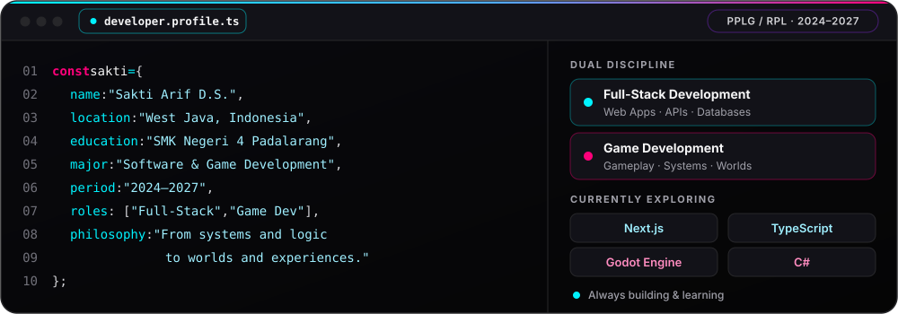
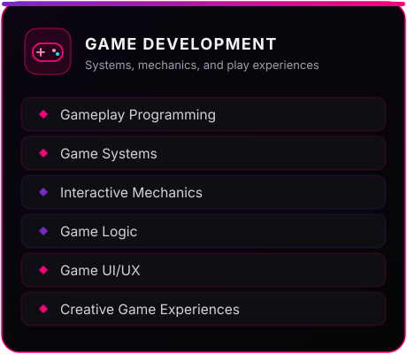
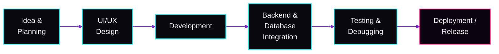
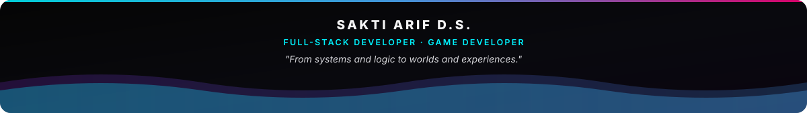

  

  

  
  
  
  

## About Me

I'm a **Software and Game Development (PPLG / RPL)** student at SMK Negeri 4 Padalarang. My journey started in web development, where I built a foundation across frontend interfaces, backend services, relational databases, and REST APIs.

That same curiosity led me to game development, where programming meets interactive mechanics, systems design, and storytelling. My goal is to keep growing as a versatile developer who can build both reliable software products and engaging interactive worlds.

  

## Developer Focus

  
  

## Tech Stack

<h3>Full-Stack Development</h3>

<i>Building responsive web interfaces, backend services, and REST APIs.</i>

 

<h3>Game Development</h3>

<i>Developing gameplay mechanics, interactive loops, and 2D/3D game systems.</i>

 

 

<h3>Database &amp; Infrastructure</h3>

<i>Managing relational data, serverless PostgreSQL, and Linux/container workflows.</i>

 

 

<h3>Tools &amp; Design</h3>

<i>Version control, UI/UX prototyping, and API testing.</i>

 

<h3>Explored &amp; Project-Specific</h3>

<i>Technologies explored and applied in dedicated mobile, ERP, and API documentation projects.</i>

 

## Experience & Organization

**Majelis Perwakilan Kelas (MPK) — SMK Negeri 4 Padalarang**  
Former Secretary General (*Sekretaris Umum*), 2025/2026

- Organizational administration, official correspondence, and documentation
- Document management and archiving
- Coordination and collaboration across student body divisions
- Organizational workflow management and record consistency

This school leadership role strengthened my communication, structured documentation, and team coordination habits.

## Featured Projects

### [CritiPlay](https://github.com/SaktiArifDwiPutra/CritiPlay)
**Full-Stack · Game Discovery, Backlog Tracker & Review Platform**

A web application where gamers discover titles, organize their backlog, and write multi-aspect reviews. Built with a React and TypeScript SPA communicating with a Laravel REST API backed by Neon PostgreSQL.

- **Technical Focus:** Token authentication via Laravel Sanctum, Google OAuth via Socialite, IGDB/Twitch API game discovery, personal game libraries, user/public profiles, and Scalar OpenAPI documentation.
- **Stack:**      -09090e?style=flat-square&logo=postgresql&logoColor=4facfe)

---

### Negeri Kelabu
**Game Development · Indonesian-Inspired Life Simulation RPG**

An ongoing game project inspired by everyday Indonesian life, centered around interactive world systems including NPC behavior, time and weather cycles, inventory, and player interactions.

- **Technical Focus:** Gameplay systems, world-state simulation, and interactive mechanics. *(Currently in development)*
- **Stack:** 

---

### [Website-Pilketos](https://github.com/SaktiArifDwiPutra/Website-Pilketos)
**Full-Stack · Digital Student Election System**

A web-based election platform built to support digital student council voting with multi-role login (admin, teacher, student), candidate profiles, and an admin dashboard displaying results as charts and tables.

- **Technical Focus:** Multi-role authentication, CRUD workflows, relational database design, and real-time result visualization.
- **Stack:**   

---

### [OSIP4](https://github.com/SaktiArifDwiPutra/OSIP4/tree/main)
**Frontend · School Organization Website**

A responsive website built for OSIP4 (SMK Negeri 4 Padalarang) for a website development competition.

- **Technical Focus:** Component-based UI architecture and responsive frontend layout.
- **Stack:**  

---

### [DausAnakSoleh](https://github.com/SaktiArifDwiPutra/DausAnakSoleh)
**Game Development · Educational Islamic Web Game**

An interactive web game designed to make learning prayer (*solat*) and Quran recitation (*mengaji*) engaging for children.

- **Technical Focus:** 2D web game loop, interactive learning stages, and browser-based edutainment UX.
- **Stack:**    

## Development Workflow

A general outline of how I approach building projects. Not every project follows every step in the same order.

## GitHub Analytics

  
  

  

  

## Contribution Snake

  <picture>
    <source media="(prefers-color-scheme: dark)" srcset="https://raw.githubusercontent.com/SaktiArifDwiPutra/SaktiArifDwiPutra/output/github-snake-dark.svg" />
    <source media="(prefers-color-scheme: light)" srcset="https://raw.githubusercontent.com/SaktiArifDwiPutra/SaktiArifDwiPutra/output/github-snake.svg" />
    
  </picture>

## Connect With Me

  
  
  

 

