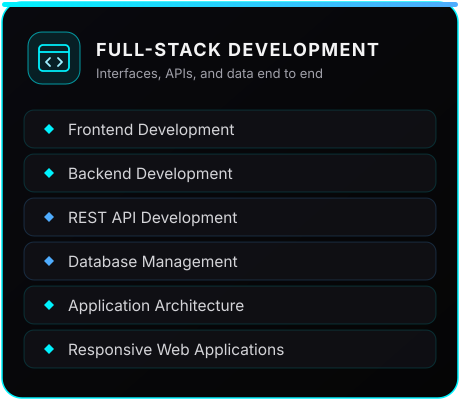
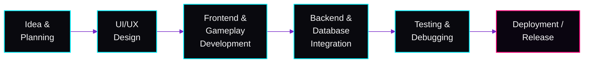

<div align="center">
  
</div>

<div align="center">
  <a href="https://github.com/SaktiArifDwiPutra">
    
  </a>
</div>

<div align="center">
  
  
  
  
</div>

## About Me

I'm a student of **Software and Game Development (PPLG / RPL)** at SMK Negeri 4 Padalarang. I started with web development, working through frontend interfaces, backend logic, databases, and APIs, and gradually got more interested in how whole applications are put together.

Game development grew out of the same curiosity. It combines programming with interaction, systems, and storytelling, and it keeps me building things people can actually play and use.

My goal is to become a versatile developer who can ship both functional software products and engaging interactive experiences.

```ts
const sakti = {
  name: "Sakti Arif D.S.",
  location: "West Java, Indonesia",
  education: "SMK Negeri 4 Padalarang · Software and Game Development (2024–2027)",
  roles: ["Full-Stack Developer", "Game Developer"],
  currentlyExploring: ["Next.js", "TypeScript", "Godot Engine", "C#"],
  philosophy: "From systems and logic to worlds and experiences.",
};
```

## Developer Focus

<div align="center">
  
  
</div>

## Tech Stack

<table>
  <tr>
    <td width="190"><b>Frontend</b></td>
    <td></td>
  </tr>
  <tr>
    <td><b>Backend</b></td>
    <td></td>
  </tr>
  <tr>
    <td><b>Database</b></td>
    <td></td>
  </tr>
  <tr>
    <td><b>Game Development</b></td>
    <td>
      <br />
      
    </td>
  </tr>
  <tr>
    <td><b>Tools &amp; Workflow</b></td>
    <td></td>
  </tr>
  <tr>
    <td><b>Additional</b></td>
    <td>
      
      
    </td>
  </tr>
</table>

## Experience & Organization

**Majelis Perwakilan Kelas (MPK) — SMK Negeri 4 Padalarang**  
Former Secretary General (*Sekretaris Umum*), 2025/2026

- Organizational administration, official correspondence, and documentation
- Document management and archiving
- Coordination and collaboration across the organization
- Managing organizational workflow and keeping records consistent

This was a school leadership role. It trained skills I also use when building software: clear communication, structure, and accountability.

## Featured Projects

<table>
  <tr>
    <td colspan="2" valign="top">

### [CritiPlay](https://github.com/SaktiArifDwiPutra/CritiPlay)
**Full-Stack · Game discovery, backlog tracking, and reviews for gaming communities**

A web platform where players discover games, track their library, and write multi-aspect reviews. The React and TypeScript frontend talks to a Laravel REST API backed by PostgreSQL (Neon).

- Token-based authentication with Laravel Sanctum and Google login through Socialite
- Personal game library with status tracking, user profiles, and public profiles
- Game discovery through the IGDB (Twitch) API
- Reviews, community discussions, and a follower system


[View repository →](https://github.com/SaktiArifDwiPutra/CritiPlay)

</td>
  </tr>
  <tr>
    <td width="50%" valign="top">

### Negeri Kelabu
**Game · Life simulation RPG**

An Indonesian-inspired life simulation RPG built around everyday life. It focuses on interactive systems such as NPC behavior, time, weather, inventory, and player interactions.


Status: in development

</td>
    <td width="50%" valign="top">

### [DausAnakSoleh](https://github.com/SaktiArifDwiPutra/DausAnakSoleh)
**Game · Educational Islamic web game**

An educational web game that makes learning prayer and Quran recitation more interactive and engaging for children.


[View repository →](https://github.com/SaktiArifDwiPutra/DausAnakSoleh)

</td>
  </tr>
  <tr>
    <td width="50%" valign="top">

### [Website-Pilketos](https://github.com/SaktiArifDwiPutra/Website-Pilketos)
**Full-Stack · Digital student election system**

A web-based student election system for school election processes. It has multi-role login for admins, teachers, and students, an interactive voting page, and an admin dashboard that shows results as charts and tables.


[View repository →](https://github.com/SaktiArifDwiPutra/Website-Pilketos)

</td>
    <td width="50%" valign="top">

### [OSIP4](https://github.com/SaktiArifDwiPutra/OSIP4/tree/main)
**Frontend · School organization website**

A responsive website for OSIP4, the student organization of SMKN 4 Padalarang, built for a website development competition.


[View repository →](https://github.com/SaktiArifDwiPutra/OSIP4/tree/main)

</td>
  </tr>
</table>

## Development Workflow

A general outline of how I approach building things. Individual projects don't always follow every step.



## GitHub Analytics

<div align="center">
  
  
</div>

<div align="center">
  
</div>

<div align="center">
  
</div>

## Contribution Snake

<div align="center">
  <picture>
    <source media="(prefers-color-scheme: dark)" srcset="https://raw.githubusercontent.com/SaktiArifDwiPutra/SaktiArifDwiPutra/output/github-snake-dark.svg" />
    <source media="(prefers-color-scheme: light)" srcset="https://raw.githubusercontent.com/SaktiArifDwiPutra/SaktiArifDwiPutra/output/github-snake.svg" />
    
  </picture>
</div>

## Connect With Me

<div align="center">
  <a href="https://github.com/SaktiArifDwiPutra"></a>
  <a href="https://www.instagram.com/saktehhhhhhh/"></a>
  <a href="mailto:saktiarif830@gmail.com"></a>
</div>

<br />

<div align="center">
  <i>"From systems and logic to worlds and experiences."</i>
</div>

<br />


